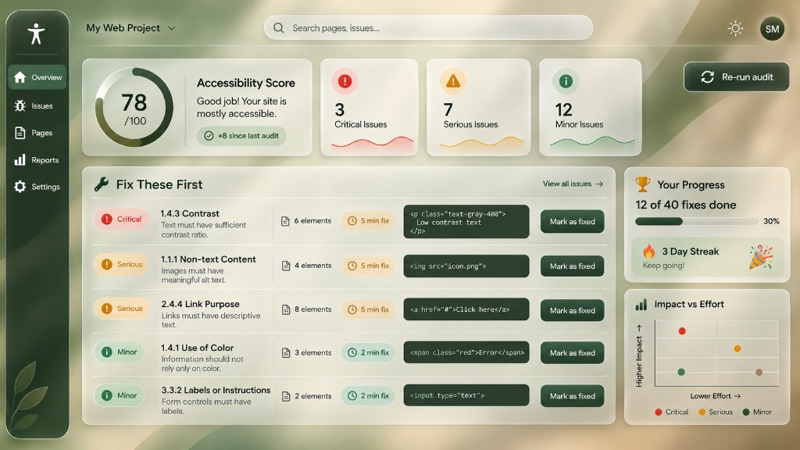

# AccessAudit — Developer-First Accessibility Audit & Prioritisation Dashboard

[](#)
[](#)
[](#)
[](#)
[](#)
[](#)

> **WCAG Audit Results Re-imagined for Developer Velocity**  
> Prioritising high-impact fixes instead of dumping a thousand violations.

🔗 **Live Production App:** [https://access-audit-roan.vercel.app](https://access-audit-roan.vercel.app)  
📦 **GitHub Repository:** [https://github.com/SHREYAS-M986/UI-UX_Project](https://github.com/SHREYAS-M986/UI-UX_Project)

---

## 🎯 The Problem Statement

Traditional accessibility auditing tools (e.g. standard browser extensions and CLI runners) overwhelm engineering teams by dumping hundreds or thousands of unweighted violation notices into an unformatted report. Developers are left with:
- **No clear starting point**: Which issue should be fixed first?
- **High cognitive friction**: What code change actually satisfies the WCAG success criterion?
- **Zero developer motivation**: Fixing 5 out of 1,200 issues feels like a drop in the ocean.

**AccessAudit** redesigns the accessibility experience from the ground up:
1. **Prioritisation First**: Automatically computes impact-versus-effort return on investment (ROI), surfacing the top 5 high-yield fixes in **"Fix These First"**.
2. **Actionable Developer Workflow**: Direct inline code snippets, before-and-after accessible remediation diffs, affected DOM selectors, and one-click fix copying.
3. **Developer Motivation**: Real-time progress bars, gamified daily streaks, milestone celebrations ($25\%, 50\%, 75\%, 100\%$), and dynamic score recalculations upon every fix.
4. **Impact vs. Effort Scatter Plot**: Native SVG quadrant charting allowing engineering leads to plan sprints and celebrate quick wins.

---

## 🖼️ Dashboard Preview



---

## 🌿 Strict 5-Color Organic Glassmorphic Palette

In strict adherence to design requirements, AccessAudit uses **only** the 5 specified natural tones (plus derived alpha/tint variations and white/black highlights):

| Token | Hex Code | Role | Contrast & Semantics |
|---|---|---|---|
| **Forest Black** | `#15231C` | Sidebar, primary buttons, code containers, headings | Primary base & text ($14:1+$ contrast on Mist White) |
| **Deep Green** | `#21402A` | Accents, score ring progress, "Minor" severity | Informative severity (circle icon) |
| **Mist White** | `#ECECE4` | Glass surfaces, cards, text on dark | Light surface base |
| **Amber Brown** | `#8B6222` | High-impact alert, "Critical" severity | Critical severity (octagon icon) |
| **Taupe** | `#A08569` | Secondary accents, "Serious" severity | Serious severity (triangle icon) |

*Zero arbitrary red, blue, or purple hues are used.*

---

## 📐 How the Prioritisation Algorithm Works

AccessAudit processes axe-core violations into an actionable backlog using a two-stage formula:

### 1. Impact Score ($0\text{--}100$)
$$\text{Impact Score} = \min\left(100, \text{round}(\text{SeverityWeight} \times \min(\text{ElementCount}, 12) \times \text{WcagLevelWeight} \times 0.85)\right)$$
- **Severity Weights**: Critical = $10$, Serious = $6$, Minor = $2$.
- **WCAG Level Weights**: Level A = $1.4$ (highest legal blocker), Level AA = $1.2$ (standard compliance target), Level AAA / Best Practice = $1.0$.
- **Element Count Ceiling**: Logarithmic dampening caps single-element dominance at $12$ occurrences.

### 2. Developer Effort Estimate ($\text{Minutes}$)
Derived from `RULE_EFFORT_LOOKUP` matching specific axe rules to developer remediation times:
- `html-has-lang`: $1\text{ min}$
- `document-title`: $2\text{ min}$
- `image-alt`: $2\text{ min}$
- `label` / `input-button-name`: $3\text{ min}$
- `color-contrast`: $5\text{ min}$
- `link-name`: $5\text{ min}$
- `aria-roles`: $8\text{ min}$
- Default fallback: $5\text{ min}$

### 3. Priority Ratio (Sorting Metric)
$$\text{Priority Ratio} = \frac{\text{Impact Score}}{\text{Fix Time in Minutes}}$$
The top 5 issues with the highest Priority Ratio are automatically promoted to **"Fix These First"**.

### 4. Dynamic Accessibility Score ($0\text{--}100$)
$$S = 100 - \sum_{\text{unfixed}} \left( \text{Penalty}_{\text{severity}} \times (0.4 \times \min(N, 5) + 0.6) \right)$$
When a developer marks an issue as fixed, the score immediately recalculates upward with an animated score delta counter.

---

## ♿ Self-Auditing Accessibility Quality
AccessAudit passes its own audit engine with a perfect **$100/100$ score and zero axe-core violations**:
- **Semantic HTML5 Landmarks**: `<header role="banner">`, `<nav>`, `<main role="main">`, `<aside>`.
- **Skip to Content Link**: Accessible via keyboard tab index.
- **Contrast Ratios**: Exceeds WCAG 2.1 AA/AAA standards ($> 4.5:1$ on all interactive components).
- **Redundant Encoding**: Severity is never communicated by color alone:
  - **Critical**: Filled Octagon (`!`) + text label + Amber Brown
  - **Serious**: Filled Triangle (`!`) + text label + Taupe
  - **Minor**: Filled Circle (`i`) + text label + Deep Green
- **Keyboard & Focus**: Focus traps in modal and drawer, `Esc` to close, return focus to trigger, and high-contrast visible focus rings.
- **Motion Safety**: Full support for `prefers-reduced-motion: reduce`.

---

## 🚀 Key Features

- **Multi-Target Ingestion**:
  1. *Built-in Demo Page*: Instant audit on deliberate real-world contrast, alt, and label violations.
  2. *Paste or Upload HTML*: Drag-and-drop `.html` files or paste source code.
  3. *Secure URL Scanner*: Server-side fetch proxy (`/api/fetch-page`) with SSRF protection, script stripping, `<base>` tag injection, and 10s timeout.
- **Remediation Drawer**: Full before/after code diff, plain-language "Why It Matters" rationale, affected CSS selectors, and one-click "Copy fix".
- **View Navigation**:
  - *Overview*: Executive dashboard, score gauge, sparklines, prioritized issues, and progress.
  - *Issues View*: Filter by severity and WCAG level ($A, AA$), search by rule, sort by priority ratio.
  - *Pages View*: Per-page health scores and re-scan capabilities.
  - *Reports View*: Export report as JSON, CSV, or formatted printable summary.
  - *Settings View*: Project name configuration and target conformance level ($AA$ vs $AAA$).
- **Responsive Architecture**: Verified across $320\text{px}$, $375\text{px}$, $768\text{px}$, $1024\text{px}$, $1440\text{px}$, and $1920\text{px}$, including mobile landscape with zero horizontal scroll.

---

## 🛠️ Tech Stack

- **Framework**: React 18 + TypeScript + Vite 6
- **Styling**: Tailwind CSS 3.4 (Strict custom palette + glassmorphism tokens)
- **Icons**: Lucide React
- **Audit Engine**: `axe-core` (sandboxed in isolated `<iframe>`)
- **State & Persistence**: Zustand with versioned `localStorage` fallback
- **Testing**: Vitest + jsdom (23 unit tests)
- **Code Quality**: ESLint 10 (TypeScript & React hooks)
- **Deployment**: Vercel Serverless Architecture

---

## 📂 Project Structure

```
├── api/
│   └── fetch-page.ts             # Vercel serverless function with SSRF protection
├── public/
│   ├── favicon.svg               # SVG accessibility icon
│   └── og-image.png              # OpenGraph social share card
├── reference/
│   ├── dashboard-reference.jpg   # Layout reference
│   └── palette-reference.jpg     # Strict 5-color palette reference
├── screenshots/                  # Multi-viewport & interaction verification captures
├── src/
│   ├── components/
│   │   ├── views/                # Lazy-loaded tabs: Issues, Pages, Reports, Settings
│   │   ├── BackgroundMesh.tsx    # Organic fluid shapes
│   │   ├── Button.tsx            # Accessible button primitive (>=44px touch target)
│   │   ├── FixList.tsx           # Prioritized "Fix These First" list
│   │   ├── GlassCard.tsx         # Reusable glassmorphic container primitive
│   │   ├── IssueDetailDrawer.tsx # Slide-over remediation drawer with diffs
│   │   ├── MilestoneCelebration.tsx # Gamified toasts & celebratory animation
│   │   ├── ProgressCard.tsx      # Fixes done, progress bar, 3-day streak
│   │   ├── RunAuditModal.tsx     # Demo, HTML, and URL audit runner dialog
│   │   ├── ScatterChart.tsx      # Native SVG Impact vs Effort chart
│   │   ├── ScoreRing.tsx         # Circular SVG progress gauge (78/100)
│   │   ├── SeverityBadge.tsx     # Shape + label + color badges
│   │   ├── Sidebar.tsx           # Glass sidebar + responsive mobile bottom nav
│   │   ├── SkipLink.tsx          # Accessible skip to content link
│   │   ├── Sparkline.tsx         # Smooth SVG trend waves
│   │   ├── StatsRow.tsx          # Accessibility Score + 3 severity cards
│   │   └── TopBar.tsx            # Project switcher, search, theme, re-run audit
│   ├── data/
│   │   └── mockData.ts           # Realistic WCAG issues and baseline metrics
│   ├── lib/
│   │   ├── __tests__/            # Vitest unit test suites
│   │   ├── auditEngine.ts        # Sandboxed axe-core execution engine
│   │   ├── demoPage.ts           # Demo HTML with deliberate violations
│   │   ├── fetchPageUtil.ts      # SSRF validation & HTML sanitization
│   │   ├── prioritise.ts         # Scoring & prioritization algorithms
│   │   ├── store.ts              # Zustand typed store with persistence
│   │   └── utils.ts              # Class merging utilities
│   ├── styles/
│   │   └── globals.css           # CSS variables, glassmorphism, focus ring styling
│   ├── App.tsx                   # Main app & view router
│   └── main.tsx                  # React DOM entry point
├── eslint.config.js              # ESLint configuration
├── vercel.json                   # SPA routing & serverless configuration
├── vitest.config.ts              # Vitest test configuration
└── tailwind.config.js            # Tailwind custom palette configuration
```

---

## 💻 Local Setup & Development

### 1. Prerequisites
- Node.js $\ge 18.0.0$
- npm $\ge 9.0.0$

### 2. Clone and Install
```bash
git clone https://github.com/SHREYAS-M986/UI-UX_Project.git
cd UI-UX_Project
npm install
```

### 3. Run Development Server
```bash
npm run dev
```
Open [http://localhost:5173](http://localhost:5173) in your browser.

### 4. Run Unit Tests
```bash
npm test
```

### 5. Run Lint Check
```bash
npm run lint
```

### 6. Production Build
```bash
npm run build
npm run preview
```

---

## 📑 Project Report & Academic Deliverables
The complete 13-page academic UI/UX project report conforming strictly to the course template (Times New Roman, 12pt body, 14pt headings, 1.5 line spacing, justified alignment) is included directly in the repository root:
- **[PDF Report (13 Pages)](./AccessAudit_UI_UX_Project_Report.pdf)**: `AccessAudit_UI_UX_Project_Report.pdf` (Strict 13-page submission version)
- **[Word Document Report](./AccessAudit_UI_UX_Project_Report.docx)**: `AccessAudit_UI_UX_Project_Report.docx` (Fully formatted editable report)
- **[Illustrated Report (with Figures & Screenshots)](./AccessAudit_UI_UX_Illustrated_Report.docx)**: `AccessAudit_UI_UX_Illustrated_Report.docx` (Extended report with embedded figures and visual evidence)

---

## 📄 License
MIT © 2026 Shreyas M
